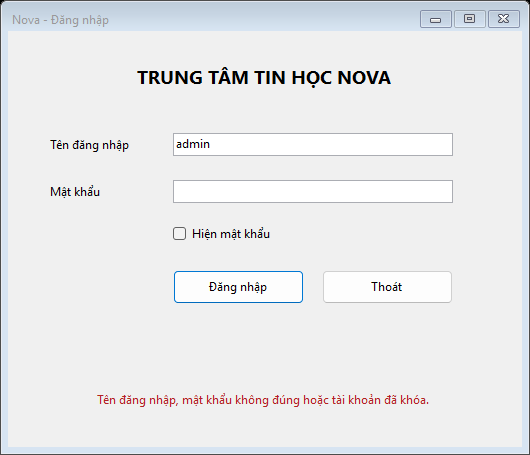
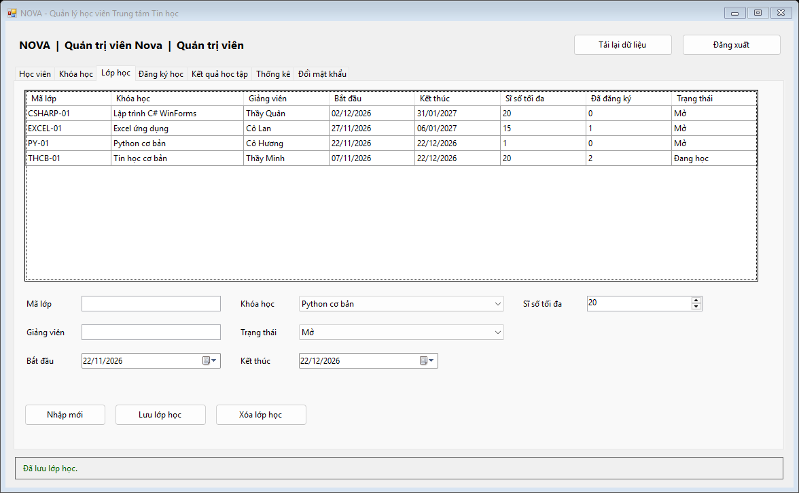
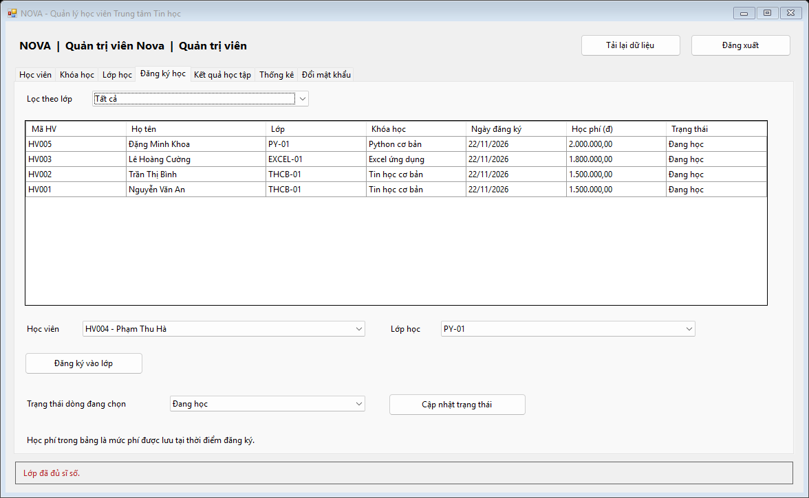
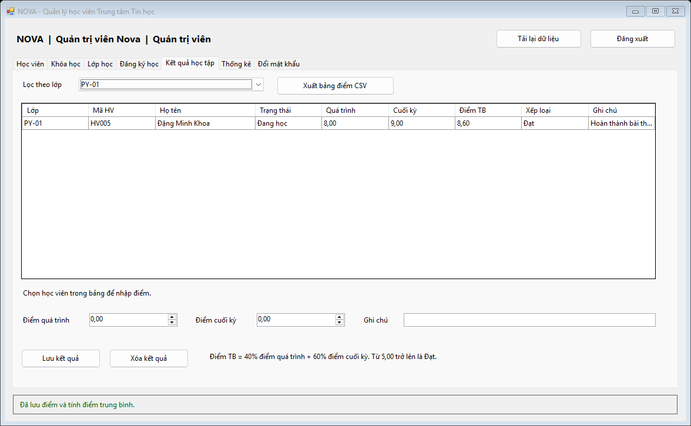

# Quản lý học viên Trung tâm Tin học Nova

Đồ án C# Windows Forms và SQL Server dành cho nhóm 3 sinh viên học môn Lập trình .NET.

## Phạm vi thực hiện

Giao diện dùng các control WinForms thông dụng như TextBox, ComboBox, DateTimePicker, Button và DataGridView. Chương trình chia DTO, DAL, BUS và GUI để tách thông tin dữ liệu, truy vấn SQL, kiểm tra nghiệp vụ và xử lý nút bấm.

| Phần việc | Chức năng |
|---|---|
| Đăng nhập | Kiểm tra tài khoản, hiện/ẩn mật khẩu, phân quyền quản trị/nhân viên và đổi mật khẩu |
| Học viên | Thêm, sửa, xóa, tìm theo mã/tên/điện thoại và xuất danh sách CSV |
| Khóa học | Thêm, sửa, xóa mã khóa, tên khóa, số giờ và học phí |
| Lớp học | Chọn khóa, nhập giảng viên, thời gian học, sĩ số tối đa và trạng thái |
| Đăng ký | Chọn học viên và lớp, lưu đăng ký, kiểm tra trùng và số chỗ còn lại |
| Kết quả | Nhập điểm quá trình/cuối kỳ, tính điểm trung bình và xếp loại |
| Thống kê | Đếm học viên theo lớp, số hoàn thành, số đạt và tổng học phí đăng ký |

Quản trị viên có quyền xóa dữ liệu. Nhân viên nhập và cập nhật thông tin đào tạo. Mỗi người có thể tự đổi mật khẩu của mình.

## Phân công nhóm 3 người

Mỗi thành viên phụ trách hai bảng dữ liệu cùng giao diện, truy vấn và kiểm tra nghiệp vụ tương ứng.

| Thành viên | Hai bảng phụ trách | Công việc |
|---|---|---|
| Thành viên 1 | TaiKhoan, HocVien | Đăng nhập, đổi mật khẩu; thêm/sửa/xóa/tìm học viên và kiểm tra thông tin nhập |
| Thành viên 2 | KhoaHoc, LopHoc | Quản lý khóa và lớp; liên kết lớp với khóa, kiểm tra ngày học, học phí và sĩ số |
| Thành viên 3 | DangKy, KetQua | Ghi danh, chống trùng, kiểm tra lớp còn chỗ; nhập điểm, xếp loại, thống kê và xuất CSV |

Khối lượng dự kiến khoảng một phần ba cho mỗi người. Bảng phân công này là kế hoạch làm việc của nhóm, tên thành viên sẽ được bổ sung khi chốt danh sách.

### File của thành viên 1

- [LoginForm.cs](NovaCenter/GUI/LoginForm.cs) và [LoginForm.Designer.cs](NovaCenter/GUI/LoginForm.Designer.cs)
- [MainForm.Students.cs](NovaCenter/GUI/MainForm.Students.cs) và [MainForm.Password.cs](NovaCenter/GUI/MainForm.Password.cs)
- [StudentService.cs](NovaCenter/BUS/StudentService.cs) và [AuthService.cs](NovaCenter/BUS/AuthService.cs)
- [StudentRepository.cs](NovaCenter/DAL/StudentRepository.cs) và [AccountRepository.cs](NovaCenter/DAL/AccountRepository.cs)

### File của thành viên 2

- [MainForm.Training.cs](NovaCenter/GUI/MainForm.Training.cs)
- [TrainingService.cs](NovaCenter/BUS/TrainingService.cs)
- [TrainingRepository.cs](NovaCenter/DAL/TrainingRepository.cs)

### File của thành viên 3

- [MainForm.Study.cs](NovaCenter/GUI/MainForm.Study.cs)
- [StudyService.cs](NovaCenter/BUS/StudyService.cs)
- [StudyRepository.cs](NovaCenter/DAL/StudyRepository.cs)
- [CsvExporter.cs](NovaCenter/BUS/CsvExporter.cs)

Mỗi người phụ trách giao diện, truy vấn, kiểm tra dữ liệu và thử chức năng trong module của mình.

### Công việc chung

- Cùng thống nhất quan hệ giữa sáu bảng trong [Schema.sql](Database/Schema.sql) và các đối tượng trong [Models.cs](NovaCenter/DTO/Models.cs).
- Dùng chung [Db.cs](NovaCenter/DAL/Db.cs), [Ui.cs](NovaCenter/GUI/Ui.cs) và [Validation.cs](NovaCenter/BUS/Validation.cs).
- [MainForm.cs](NovaCenter/GUI/MainForm.cs) nạp dữ liệu và gọi ba nhóm xử lý. Khi ghép bài, cập nhật bố cục các tab trong [MainForm.Designer.cs](NovaCenter/GUI/MainForm.Designer.cs) cùng một lượt để tránh sửa trùng file.
- Mỗi người tự kiểm tra dữ liệu đúng, dữ liệu thiếu/sai và trường hợp trùng của module mình.
- Cả nhóm thử luồng từ học viên → lớp → đăng ký → kết quả; chụp ảnh, hoàn thiện README và chuẩn bị thuyết trình. Khi bảo vệ, mỗi người trình bày phần mã nguồn mình phụ trách.

## Làm việc nhóm bằng Git

Repo chung dự kiến là `NguyenHaiDang04/NovaCenter`. Mỗi thành viên tải một bản về máy và làm trên nhánh tương ứng.

| Thành viên | Nhánh | Phần việc |
|---|---|---|
| Thành viên 1 | `hoc-vien` | Đăng nhập, học viên và đổi mật khẩu |
| Thành viên 2 | `khoa-lop` | Khóa học và lớp học |
| Thành viên 3 | `dang-ky-diem` | Đăng ký, kết quả và thống kê |

1. Clone repo về máy rồi mở `NovaCenter.sln`.
2. Chuyển sang nhánh được phân công trước khi sửa code.
3. Commit phần thay đổi của mình, push nhánh lên GitHub và tạo pull request vào `main`.
4. Một thành viên khác xem thay đổi và ghép bài. Sau khi ghép, cả nhóm cập nhật bản mới về máy.
5. Những file chung như `MainForm.Designer.cs` và `Schema.sql` được thống nhất trước khi sửa.

## Cách chạy trên máy

1. Cài Visual Studio với **.NET desktop development**, .NET Framework 4.8 Developer Pack và SQL Server LocalDB.
2. Mở [NovaCenter.sln](NovaCenter.sln), nhấn **F5**.
3. Ứng dụng tự tạo `NovaCenterDB`, bảng, dữ liệu và tài khoản mẫu ở lần chạy đầu.
4. Nếu dùng instance SQL Server khác, sửa chuỗi kết nối trong [App.config](NovaCenter/App.config). Có thể chạy trước [ScriptDB.sql](Database/ScriptDB.sql) bằng SSMS.

| Tài khoản mẫu | Mật khẩu | Quyền |
|---|---|---|
| admin | Admin@123 | Quản trị viên |
| nhanvien | Nova@123 | Nhân viên |

Trong tab danh mục, bấm **Nhập mới** để thêm. Chọn một dòng trong bảng để sửa rồi bấm **Lưu**. Chương trình hỏi xác nhận trước khi xóa.

## Quy tắc cần giải thích khi bảo vệ

- Mã học viên, khóa và lớp phải duy nhất.
- Một học viên có một đăng ký cho mỗi lớp. Đăng ký đã hủy có thể được khôi phục khi còn chỗ.
- Học viên hoặc khóa ngừng hoạt động, lớp kết thúc hay lớp đã đầy sẽ không nhận đăng ký mới.
- Khi lưu đăng ký, kiểm tra sĩ số và ghi dữ liệu trong cùng giao dịch để giữ đúng số chỗ.
- Học phí được lưu theo thời điểm đăng ký.
- Điểm trong khoảng 0–10. Điểm TB = 40% quá trình + 60% cuối kỳ. Từ 5 trở lên là Đạt.
- Dữ liệu liên quan được bảo vệ bằng khóa ngoại. Đăng ký có điểm cần xóa điểm trước khi hủy.
- Tổng học phí trong thống kê là giá trị các đăng ký, chưa phải số tiền đã thu.

## Kiểm tra chương trình

Mở PowerShell trong thư mục dự án rồi chạy:

```powershell
.\Verify.ps1
```

Script build và thử thao tác form trên CSDL LocalDB riêng, lưu ảnh/log vào `TestOutput` và xóa CSDL thử khi xong. Bản thu gọn đạt **37/37 kiểm tra**. Xem [nhật ký kiểm tra](docs/images/verification.txt).

## Hình ảnh











