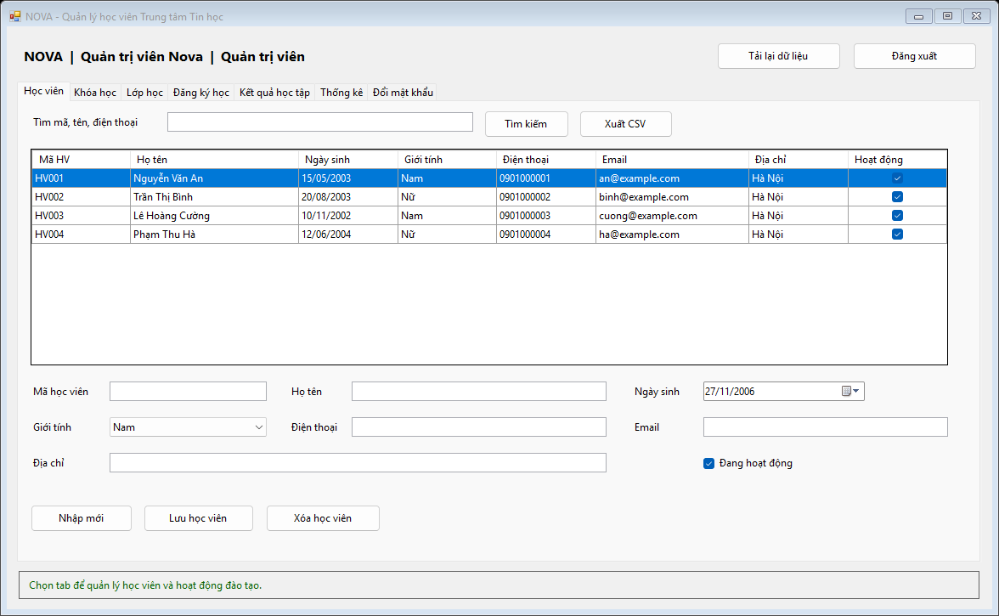
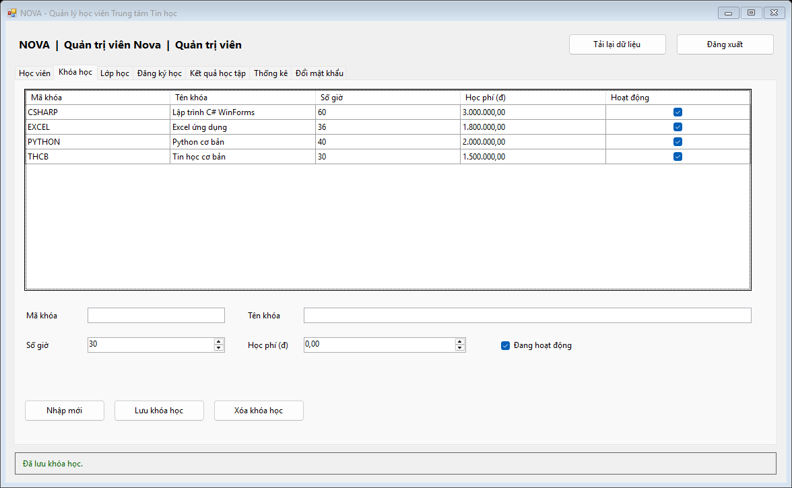
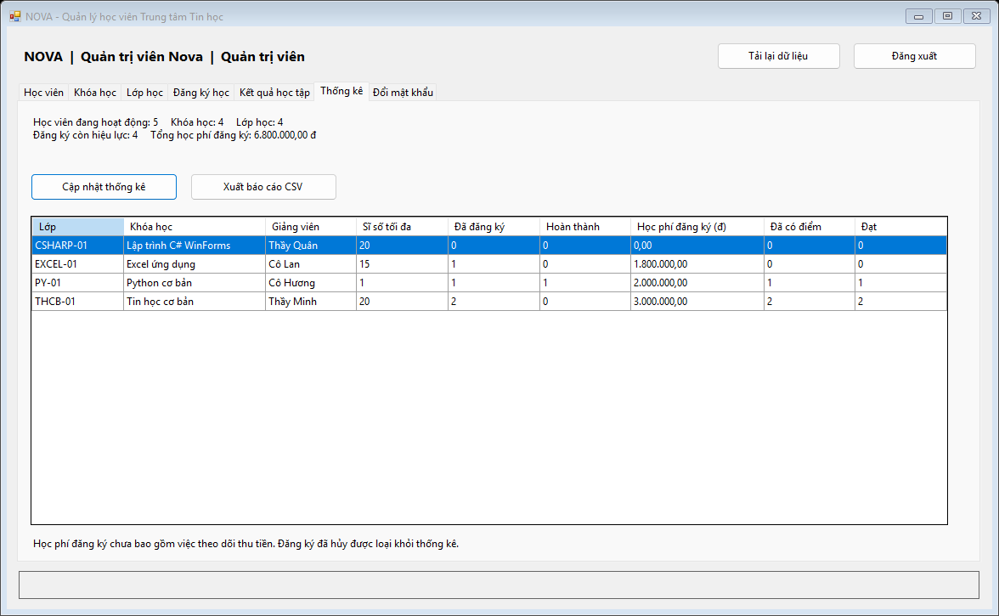
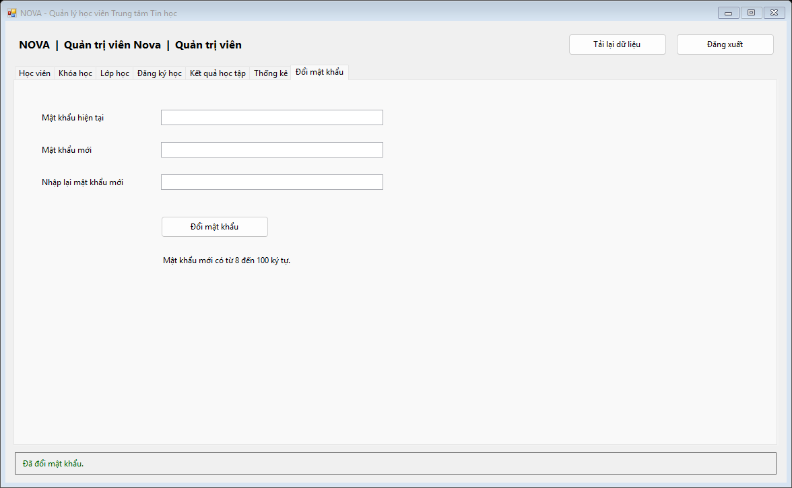

# ĐỒ ÁN CUỐI KỲ MÔN LẬP TRÌNH .NET

## 1. Thông tin đề tài và nhóm

**Tên đề tài**

Xây dựng phần mềm quản lý học viên tại Trung tâm Tin học Nova

**Lớp**

D19QTANM1

| STT | Họ và tên | Mã sinh viên | Module phụ trách |
|---|---|---|---|
| 1 | Nguyễn Hải Đăng | 24810320310 | Đăng nhập và học viên |
| 2 | Đoàn Thành Đạt | 24810320056 | Khóa học và lớp học |
| 3 | Ngô Hoàng Hải | 24810320650 | Đăng ký, kết quả và thống kê |

**Repo của nhóm**

[NguyenHaiDang04/project-cuoi-khoa](https://github.com/NguyenHaiDang04/project-cuoi-khoa)

## 2. Giới thiệu và mục tiêu

Trung tâm Tin học Nova cần theo dõi thông tin học viên, các khóa đang mở, danh sách lớp, đăng ký và kết quả học tập. Chương trình hỗ trợ nhân viên nhập dữ liệu, tra cứu và xem thống kê trên cùng một ứng dụng Windows Forms.

Mục tiêu của đề tài là vận dụng các kiến thức đã học về C#, WinForms, kiểm tra dữ liệu nhập và ADO.NET với SQL Server. Phạm vi thực hiện gồm sáu bảng dữ liệu và các màn hình quản lý cơ bản.

[Phân tích yêu cầu, quy tắc nghiệp vụ và tiêu chí kiểm tra](docs/PHAN_TICH_YEU_CAU.md).

### Tài liệu để từng thành viên bắt đầu

- [Hướng dẫn từng bước và phân công theo file](docs/HUONG_DAN_THUC_HIEN.md) gồm cách chạy, đọc code, bài thực hành chung và cách ghép bằng Git.
- [Ma trận kiểm thử chi tiết](docs/KE_HOACH_KIEM_THU.md) gồm 22 nhóm tình huống, kết quả mong đợi, người phụ trách và những mục cần thử tay.

## 3. Chức năng của chương trình

| Module | Chức năng |
|---|---|
| Đăng nhập | Kiểm tra tài khoản, hiện/ẩn mật khẩu, phân quyền và đổi mật khẩu |
| Học viên | Thêm, sửa, xóa, tìm theo mã/tên/điện thoại và xuất CSV |
| Khóa học | Quản lý mã khóa, tên khóa, thời lượng, học phí và trạng thái |
| Lớp học | Chọn khóa, nhập giảng viên, thời gian học, sĩ số và trạng thái |
| Đăng ký | Ghi danh, kiểm tra trùng, kiểm tra chỗ còn lại và cập nhật trạng thái |
| Kết quả | Nhập điểm quá trình, cuối kỳ, tính điểm trung bình và xếp loại |
| Thống kê | Đếm học viên theo lớp, số hoàn thành, số đạt, tổng học phí đăng ký và xuất CSV |

Quản trị viên có quyền thêm, sửa và xóa. Nhân viên được nhập, cập nhật và xem dữ liệu đào tạo. Quyền xóa được kiểm tra trong tầng BUS.

### Quy tắc nghiệp vụ

- Mã học viên, khóa và lớp phải duy nhất.
- Ngày sinh phải trước hôm nay. Ngày kết thúc lớp phải từ ngày bắt đầu trở đi.
- Một học viên có một đăng ký cho mỗi lớp. Lớp đầy, lớp đã kết thúc hoặc khóa ngừng hoạt động sẽ không nhận đăng ký mới.
- Đăng ký đã hủy có thể khôi phục nếu còn chỗ. Đăng ký có điểm cần xóa điểm trước khi hủy.
- Học phí được lưu theo thời điểm đăng ký.
- Lớp đã có đăng ký giữ nguyên khóa học. Có thể cập nhật giảng viên, ngày học hoặc trạng thái của lớp cũ khi khóa đó ngừng hoạt động.
- Điểm trong khoảng 0–10. Nhóm sử dụng công thức **40% điểm quá trình + 60% điểm cuối kỳ**, làm tròn hai chữ số và xếp loại Đạt từ 5 trở lên.
- Tổng học phí trong thống kê là giá trị đăng ký. Phần thu tiền và công nợ nằm ngoài phạm vi phiên bản này.

Công thức điểm và quy tắc ghi danh là quy ước của nhóm cho đề tài.

## 4. Công nghệ và cấu trúc mã nguồn

- C# và .NET Framework 4.8.
- Windows Forms với TextBox, ComboBox, DateTimePicker, Button, ErrorProvider và DataGridView.
- SQL Server LocalDB hoặc SQL Server.
- ADO.NET dùng SqlConnection, SqlCommand, SqlParameter, SqlDataAdapter và SqlTransaction.

```text
project-cuoi-khoa/
├── README.md
├── NovaCenter.sln
├── Database/
│   ├── ScriptDB.sql
│   └── Schema.sql
├── NovaCenter/
│   ├── DTO/
│   ├── DAL/
│   ├── BUS/
│   ├── GUI/
│   │   ├── LoginForm.cs
│   │   ├── LoginForm.Designer.cs
│   │   ├── MainForm.cs
│   │   ├── MainForm.Designer.cs
│   │   └── MainForm.*.cs
│   ├── Tests/
│   ├── App.config
│   └── Program.cs
├── docs/
│   ├── PHAN_TICH_YEU_CAU.md
│   └── images/
└── Verify.ps1
```

DTO chứa đối tượng dữ liệu. DAL thực hiện truy vấn SQL. BUS kiểm tra dữ liệu, quyền sử dụng và quy tắc nghiệp vụ. GUI hiển thị và xử lý các nút bấm. Các file `MainForm.*.cs` chia phần xử lý của cùng một form theo module.

## 5. Thiết kế CSDL

| Bảng | Nội dung chính |
|---|---|
| TaiKhoan | Tên đăng nhập, họ tên, mật khẩu đã băm, vai trò và trạng thái |
| HocVien | Mã học viên, họ tên, ngày sinh, giới tính và liên hệ |
| KhoaHoc | Mã khóa, tên khóa, số giờ, học phí và trạng thái |
| LopHoc | Mã lớp, khóa học, giảng viên, ngày học và sĩ số |
| DangKy | Học viên, lớp, ngày đăng ký, học phí và trạng thái |
| KetQua | Đăng ký, điểm quá trình, điểm cuối kỳ, điểm TB và ghi chú |

Quan hệ dữ liệu gồm KhoaHoc → LopHoc, HocVien → DangKy, LopHoc → DangKy và DangKy → KetQua. Tài khoản dùng để đăng nhập và phân quyền.

[Script tạo CSDL và dữ liệu mẫu](Database/ScriptDB.sql).

## 6. Phân công nhóm

| Thành viên | Hai bảng phụ trách | Các file xử lý chính | Nhánh |
|---|---|---|---|
| Nguyễn Hải Đăng | TaiKhoan, HocVien | LoginForm, MainForm.Students, MainForm.Password, AuthService, StudentService, AccountRepository, StudentRepository | `hoc-vien` |
| Đoàn Thành Đạt | KhoaHoc, LopHoc | MainForm.Training, TrainingService, TrainingRepository | `khoa-lop` |
| Ngô Hoàng Hải | DangKy, KetQua | MainForm.Study, StudyService, StudyRepository, CsvExporter | `dang-ky-diem` |

Mỗi thành viên phụ trách giao diện, truy vấn, kiểm tra dữ liệu và thử chức năng của module mình. Các phần dùng chung gồm [Models.cs](NovaCenter/DTO/Models.cs), [Db.cs](NovaCenter/DAL/Db.cs), [Ui.cs](NovaCenter/GUI/Ui.cs), [Validation.cs](NovaCenter/BUS/Validation.cs), bố cục form và script CSDL.

Cả nhóm thống nhất cấu trúc bảng, ghép chương trình, kiểm thử luồng hoàn chỉnh và chuẩn bị báo cáo, thuyết trình. Bảng trên thể hiện nhiệm vụ của từng thành viên.

## 7. Hướng dẫn cài đặt và chạy

### Môi trường

- Windows.
- Visual Studio có workload **.NET desktop development** và .NET Framework 4.8 Developer Pack.
- SQL Server LocalDB hoặc SQL Server.

### Các bước chạy

1. Tải repo về máy bằng lệnh sau.

   ```powershell
   git clone https://github.com/NguyenHaiDang04/project-cuoi-khoa.git
   ```

2. Mở [NovaCenter.sln](NovaCenter.sln) trong thư mục `project-cuoi-khoa`.
3. Chọn project **NovaCenter** làm Startup Project, nhấn **F5**.
4. Lần chạy đầu, ứng dụng tự tạo `NovaCenterDB`, bảng, dữ liệu và tài khoản mẫu.
5. Nếu dùng instance SQL Server khác, sửa `Data Source` trong [App.config](NovaCenter/App.config). Có thể chạy trước [ScriptDB.sql](Database/ScriptDB.sql) bằng SSMS. Tài khoản kết nối cần quyền tạo CSDL khi CSDL chưa tồn tại.

| Tài khoản mẫu | Mật khẩu | Quyền |
|---|---|---|
| admin | Admin@123 | Quản trị viên |
| nhanvien | Nova@123 | Nhân viên |

### Thao tác chức năng

- Bấm **Nhập mới** trước khi thêm học viên, khóa hoặc lớp. Chọn một dòng trong bảng để sửa rồi bấm **Lưu**.
- Tab **Đăng ký học** chọn học viên và lớp rồi bấm **Đăng ký vào lớp**.
- Tab **Kết quả học tập** lọc lớp, chọn học viên, nhập hai điểm và bấm **Lưu kết quả**.
- Tab **Thống kê** bấm **Cập nhật thống kê** hoặc **Xuất báo cáo CSV**.
- Tab **Đổi mật khẩu** yêu cầu nhập mật khẩu hiện tại và xác nhận mật khẩu mới.

### Làm việc trên GitHub

Mỗi thành viên chuyển sang nhánh được phân công trước khi sửa code, commit phần thay đổi và tạo pull request vào `main`. Những file chung như `MainForm.Designer.cs` và `Schema.sql` được thống nhất trước khi sửa. Sau khi ghép bài, cả nhóm cập nhật bản mới về máy.

## 8. Kiểm thử và đánh giá

Bộ kiểm thử đi qua đăng nhập, CRUD, tìm kiếm, ghi danh, chặn trùng/chặn lớp đầy, nhập điểm, phân quyền và xuất CSV. Có kiểm tra khởi tạo CSDL nhiều lần, giữ học phí cũ, cập nhật lớp thuộc khóa ngừng hoạt động và hai thao tác cùng đăng ký suất cuối.

Bản nộp đã build thành công và đạt **45/45 kiểm tra** trên Windows với SQL Server LocalDB. [Nhật ký kết quả thực tế](docs/images/verification.txt).

45 ca tự động xác nhận những luồng có trong bộ kiểm tra. Hộp thoại xác nhận xóa, chọn nơi lưu CSV và chạy trên máy thứ hai còn cần nhóm thử tay theo [kế hoạch kiểm thử](docs/KE_HOACH_KIEM_THU.md).

Có thể chạy lại bằng PowerShell tại thư mục chứa solution.

```powershell
.\Verify.ps1
```

Script dùng CSDL `Nova_Test_...` riêng, lưu ảnh/log trong `TestOutput` và xóa CSDL thử sau khi kết thúc.

## 9. Hình ảnh chương trình

### Đăng nhập


### Quản lý học viên



### Quản lý khóa học



### Quản lý lớp học


### Đăng ký và thông báo lớp đầy


### Kết quả học tập


### Thống kê



### Đổi mật khẩu


